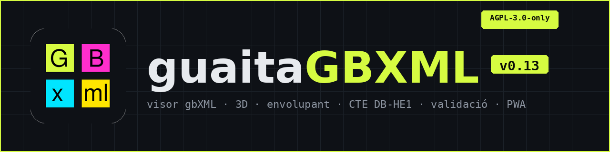

<!-- SPDX-License-Identifier: AGPL-3.0-only · Copyright (c) 2026 SBS BiM Consulting, Jordi Subirós -->

<b>🇨🇦 <a href="#català">Català</a></b> · <b>🇬🇧 <a href="#english">English</a></b>

---

## Català

**guaitaGBXML** és un visor i analitzador de fitxers **gbXML** per al navegador. Permet explorar el model en 3D, revisar les dades de construcció, comparar dues versions d'un projecte i validar les dades abans de passar el model a simulació. És un **sol fitxer HTML**: no hi ha servidor, ni comptes, ni cap dada que surti del teu ordinador. Forma part de la suite **Guaita Apps**.

El model es mostra **tal com és**: la geometria és de només lectura. L'edició afecta només les dades (noms, tipus i construccions).

### Instal·la-la com a aplicació (PWA)

**PWA** vol dir *aplicació web progressiva*: instal·la guaitaGBXML a l'ordinador o al mòbil i s'obre en finestra pròpia. Després de la primera càrrega, funciona sense connexió.

- **Chrome / Edge:** icona d'instal·lar a la barra d'adreces, o menú ⋮ / ··· → «Instal·la guaitaGBXML».
- **Android:** menú del navegador → «Afegeix a la pantalla d'inici».
- Cal servir-la per HTTPS (p. ex. GitHub Pages). En obrir el fitxer en local (`file://`) funciona com a pàgina normal, però no s'instal·la.

### Funcions

| | |
|---|---|
| 🧊 **Visor 3D** | Vistes ortogonals i en perspectiva, cub de vista, panell de navegació i disposicions de diverses vistes |
| 📐 **Seccions** | Doble lliscant: Z vertical amb marques de plantes, X i Y, i rotació del pla de tall |
| 🏠 **Dades de construcció** | Espais, superfícies, obertures, construccions, capes, materials i zones, amb taules i selecció al model |
| ✏️ **Edició de dades** | Noms, tipus i construccions, amb desfer i refer; la geometria no es modifica |
| ⚡ **Envolupant** | Àrees, U calculada des de les capes (amb avís si no coincideix amb la declarada), WWR, compacitat i K |
| 📏 **Límits CTE DB-HE1** | Comparació per zona climàtica (α a E) |
| ☀️ **Sol i ombres** | Posició solar per data i hora, i ombres sobre el model; matriu d'adjacències |
| ✅ **Validació** | Més de vint codis d'avís, cadascun vinculat a l'element afectat |
| 🔀 **Comparar models** | Afegits, eliminats i canviats entre dos fitxers gbXML |
| 📤 **Exportació** | Taules en CSV i XLS; geometria en OBJ, MTL i glTF |
| ⏱ **Fitxers grans** | Processament en segon pla (Web Worker) i taules virtuals, per a models de desenes de milers de superfícies |

### Fitxers

| Fitxer | Ús |
|---|---|
| `app/guaitaGBXML.html` | L'aplicació (un sol fitxer, versió 0.13, interfície en català) |
| `manifest.webmanifest`, `sw.js`, `icons/` | Instal·lació com a PWA i ús sense connexió; **han d'estar a l'arrel** |
| `pageCAT/index.html`, `pageCAT/ajuda.html` | Landing i manual en català |
| `pagesENG/index.html`, `pagesENG/help.html` | Landing i manual en anglès |
| `images/` | Imatges de presentació |

### Ús

1. Obre `app/guaitaGBXML.html` (o la landing de [`pageCAT/index.html`](pageCAT/index.html)).
2. Obre un fitxer `.xml` o `.gbxml` amb el botó d'obrir, o arrossega'l a la finestra.
3. Explora el model, revisa l'envolupant i la validació, corregeix les dades que calgui i exporta els resultats.

📘 **Manual complet:** [`pageCAT/ajuda.html`](pageCAT/ajuda.html)

### Limitacions conegudes

- No és una eina oficial de certificació ni de justificació del CTE. Els resultats són indicatius i no substitueixen un càlcul justificatiu.
- Un fitxer gbXML pot contenir errors de codificació (per exemple, noms en UTF-8 llegits com a text doble) o dades incompletes. L'app els assenyala, però la verificació final és responsabilitat de l'usuari.
- L'anàlisi només considera l'envolupant i les dades que el fitxer conté: no inclou instal·lacions ni interiors.

### Contribuir

Les contribucions són benvingudes. Abans d'enviar una pull request, cal acceptar el [CLA v1.0](https://github.com/subi2/guaitaPDF/blob/main/CLA.md) (Acord de Llicència de Contribuïdor) i incloure la línia `Signed-off-by` a cada commit.

### Components i llicència

[Three.js](https://threejs.org/) (MIT) · IBM Plex (SIL Open Font License 1.1) — tots incrustats.

Programari lliure sota la [GNU Affero General Public License v3.0 (AGPL-3.0-only)](LICENSE). © 2026 Jordi Subirós · SBS BiM Consulting.

---

## English

**guaitaGBXML** is a viewer and analyser for **gbXML** files that runs in the browser. It lets you explore the model in 3D, review construction data, compare two versions of a project and validate the data before passing the model to simulation. It is a **single HTML file**: there is no server, no accounts, and no data leaves your computer. It is part of the **Guaita Apps** suite.

The model is shown **as it is**: geometry is read-only. Editing affects the data only (names, types and constructions).

### Install it as an app (PWA)

**PWA** means *progressive web app*: install guaitaGBXML on your computer or phone. It opens in its own window. After the first load, it works offline.

- **Chrome / Edge:** install icon in the address bar, or ⋮ / ··· menu → “Install guaitaGBXML”.
- **Android:** browser menu → “Add to Home screen”.
- Serve it over HTTPS (e.g. GitHub Pages). Opened locally (`file://`) it works as a normal page, but cannot be installed.

### Features

| | |
|---|---|
| 🧊 **3D viewer** | Orthogonal and perspective views, view cube, navigation panel and multi-view layouts |
| 📐 **Sections** | Dual slider: Z vertical with storey marks, X and Y, and cutting-plane rotation |
| 🏠 **Construction data** | Spaces, surfaces, openings, constructions, layers, materials and zones, with tables and selection in the model |
| ✏️ **Data editing** | Names, types and constructions, with undo and redo; geometry is never modified |
| ⚡ **Envelope** | Areas, U-value calculated from layers (warning if it differs from the declared one), WWR, compactness and K |
| 📏 **CTE DB-HE1 limits** | Comparison by climate zone (α to E) |
| ☀️ **Sun and shadows** | Sun position by date and time, shadows on the model; adjacency matrix |
| ✅ **Validation** | More than twenty warning codes, each linked to the affected element |
| 🔀 **Model comparison** | Added, removed and changed items between two gbXML files |
| 📤 **Export** | Tables as CSV and XLS; geometry as OBJ, MTL and glTF |
| ⏱ **Large files** | Background processing (Web Worker) and virtual tables, for models with tens of thousands of surfaces |

### Files

| File | Use |
|---|---|
| `app/guaitaGBXML.html` | The application (single file, version 0.13, Catalan interface) |
| `manifest.webmanifest`, `sw.js`, `icons/` | PWA install and offline use; **must be at the root** |
| `pageCAT/index.html`, `pageCAT/ajuda.html` | Catalan landing and manual |
| `pagesENG/index.html`, `pagesENG/help.html` | English landing and manual |
| `images/` | Presentation images |

### Usage

1. Open `app/guaitaGBXML.html` (or the landing page [`pagesENG/index.html`](pagesENG/index.html)).
2. Open a `.xml` or `.gbxml` file with the open button, or drag it into the window.
3. Explore the model, review the envelope and validation, correct the data where needed and export the results.

📘 **Full guide:** [`pagesENG/help.html`](pagesENG/help.html)

### Known limitations

- Not an official certification or CTE compliance tool. Results are indicative and do not replace a formal calculation report.
- A gbXML file may contain encoding errors (for example, UTF-8 names read as double-encoded text) or incomplete data. The app flags them, but final verification is the user's responsibility.
- The analysis only covers the envelope and the data contained in the file: it does not include building services or interiors.

### Contributing

Contributions are welcome. Before opening a pull request, please accept the [CLA v1.0](https://github.com/subi2/guaitaPDF/blob/main/CLA.md) (Contributor License Agreement) and add a `Signed-off-by` line to each commit.

### Components and licence

[Three.js](https://threejs.org/) (MIT) · IBM Plex (SIL Open Font License 1.1) — all embedded.

Free software under the [GNU Affero General Public License v3.0 (AGPL-3.0-only)](LICENSE). © 2026 Jordi Subirós · SBS BiM Consulting.

---

> Guaita Apps es distribueix «tal com és», sense cap garantia. / Guaita Apps is distributed “as is”, without any warranty.
